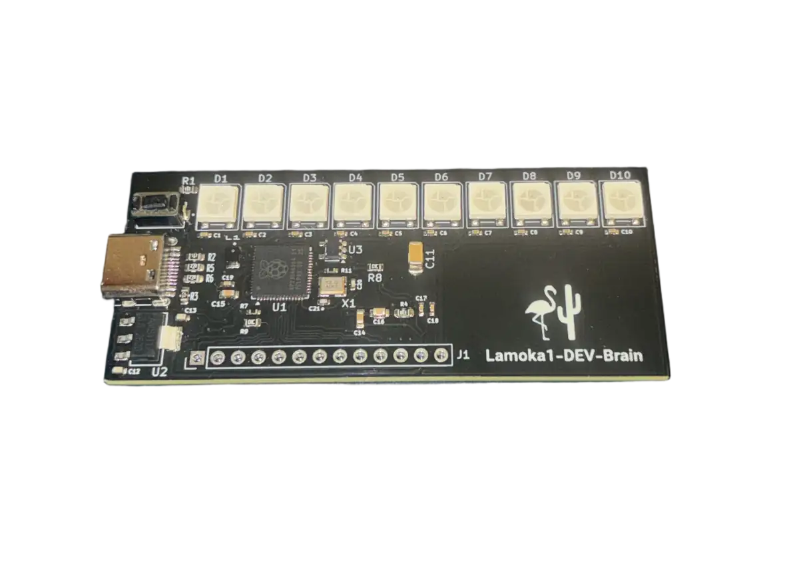

  

  <strong>Lamoka1-DEV-Brain</strong>

  This board can now be ordered
  <a href="https://www.pcbway.com/project/shareproject/Lamoka1_DEV_Brain_49e4fd0a.html">here</a>.

  PIE versions v1.8 and below will function on this board.
  For more information on PIE, go
  <a href="SOFTWARE/README.md">here</a>.

  <a href="https://htmlpreview.github.io/?https://raw.githubusercontent.com/bearjhartjen/Lamoka1-DEV-Brain/master/HARDWARE/Kicad%20files/BOM/Lamoka1-DEV-Brain.html">
    <strong>View Interactive BOM</strong>
  </a>

---

## What this board is

The DEV-Brain brings the Lamoka1's MCU, lights and simplicity into a 70 × 30 mm
laminated sandwich (PCB). It carries the RP2354A microcontroller, one button,
ten addressable RGB LEDs (D1–D10) and a USB-C port.

It is a **prototype of the Lamoka1's control section**, and a product in its own
respect. We develop the PIE firmware on it, because
the control side is a big driver to the creativity and flexability of our products, and because it means we can
work on the lights and the button without ever having the power stage on the
bench, lowering risk and cost for development. 

Flamingo and Cactus have paid PCBWay to manufacture and assemble the DEV-Brain.
It has arrived and works much better than expected.

This board was run through Tomachie to get the design checked; the link is
[here](https://tomachie.com/r/a1f3f256-a8ca-43de-aa92-e70ef981c3c2/Lamoka1-DEV-board_report.html#design-summary).

## How to order your own 

We have published the board to PCBWay's share projects platform
[here](https://www.pcbway.com/project/shareproject/Lamoka1_DEV_Brain_49e4fd0a.html).
There, you will be able to order the Lamoka1-DEV-Brain exactly as we did.

## Tests

We were able to run the Lamoka1-DEV-Brain for 72 hours running the idle blue dot bouncing animation seen in [PIE v1.8](SOFTWARE/Portal%20Interface%20Engine/V1.8.ino). The environment was an average of 70 degrees Fahrenheit, and an average humidity of 70 percent. We stopped the test early (there were no signs of issues) because we needed to use the Lamoka1-DEV-Brain to test the HTML file creation concept for getting diagnostic data off of the Lamoka1.
